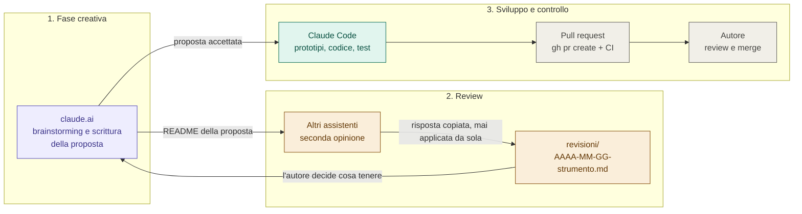
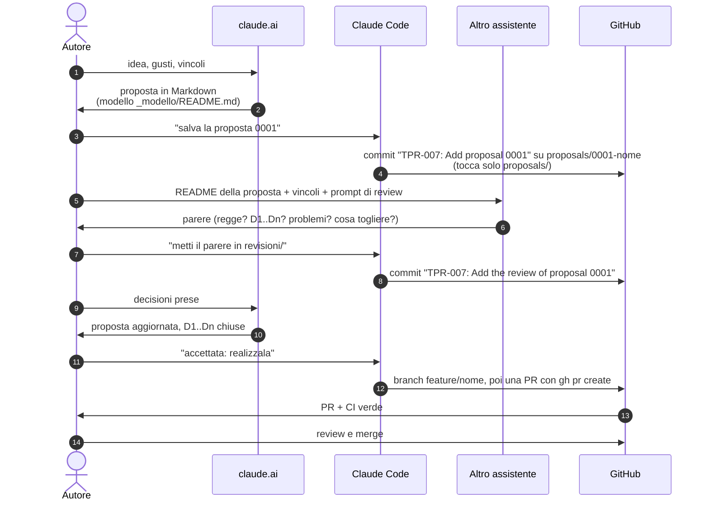
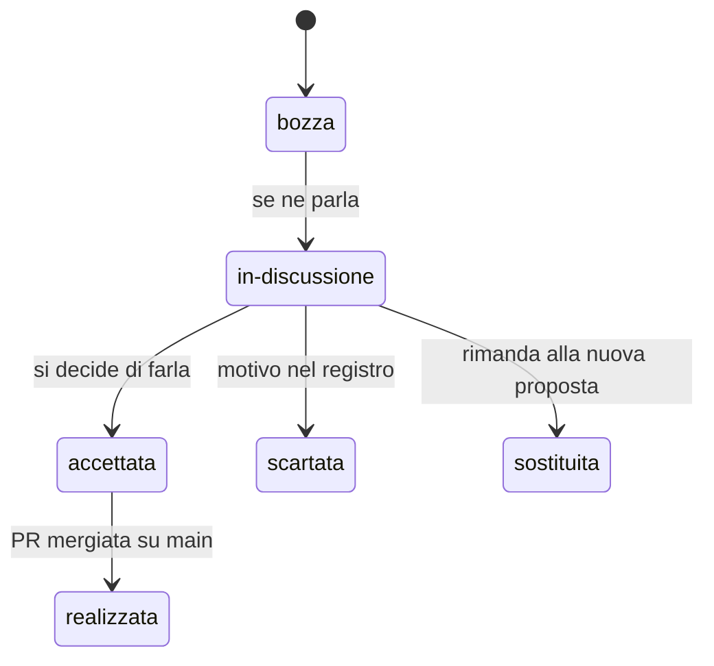
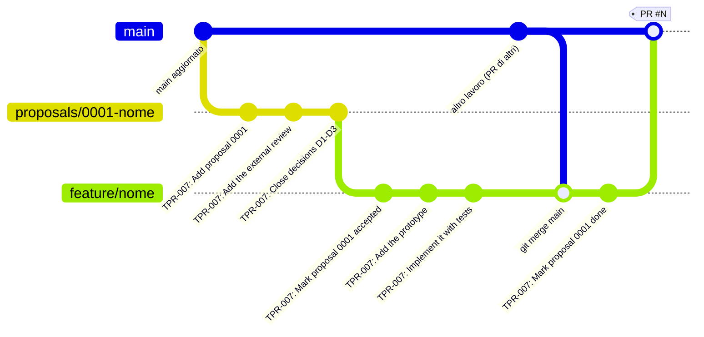

# Lo statuto in pratica: strumenti IA, review e branch

Guida illustrata allo [statuto](../CLAUDE.md): chi fa cosa nella fase creativa,
come funziona la review di un secondo assistente, quale **strategia di branch**
segue una proposta dall'idea al merge. **Le regole stanno solo in
[CLAUDE.md](../CLAUDE.md)** (branch, commit, convenzioni) e in
[proposals/README.md](../proposals/README.md) (stati e modello delle proposte):
qui il quadro d'insieme, che le richiama senza duplicarle. Se le due cose
divergono, vale il testo delle regole.

I diagrammi sono Mermaid: GitHub li disegna da solo.

## 1. Le tre fasi e gli strumenti

| Chi | Fase | Legge | Scrive | Non fa mai |
|---|---|---|---|---|
| **claude.ai** (o altra chat) | creativa | `main`, la proposta | il testo della proposta | codice nel repo |
| **Altri assistenti** | review | README della proposta + vincoli di `CLAUDE.md` | solo la risposta, che finisce in `revisioni/` | modificare la proposta |
| **Claude Code** | sviluppo | tutto il repo | prototipi, codice, documenti, stato e registro della proposta | un commit senza ok (in sessione interattiva), il merge, un push su `main` |
| **GitHub** | controllo | - | - | - |
| **L'autore** | tutte | tutto | le decisioni, l'ok ai commit | - |

GitHub tiene i due capi del lavoro: il **contratto** (la proposta o la issue
dicono cosa si vuole e quando è fatto) e il **controllo** (la PR mostra cosa è
cambiato, la CI rilancia i test, niente entra in `main` senza review).

Un assistente **non decide**: propone. Ogni decisione passa dall'autore e viene
scritta nel registro della proposta (`D1`, `D2`, ... con data e motivo).

## 2. La fase creativa e la review

- **Il repo è il canale.** claude.ai e Claude Code non si parlano: si passano
  tutto attraverso i file (e le persone).
- **Il parere esterno non cambia la proposta da solo.** Si salva com'è in
  `revisioni/`, poi l'autore scrive in fondo "Cosa ne teniamo" e le decisioni
  vere entrano nel README della proposta e nel suo registro.
- **La proposta è autosufficiente**: chi la legge senza conoscere il progetto
  deve poter rispondere. I vincoli stanno in un posto solo (`CLAUDE.md`).
- I prompt pronti per claude.ai, per Claude Code e per un assistente esterno
  sono in [proposals/README.md](../proposals/README.md#chi-fa-cosa).

## 3. Il percorso in sei passi

1. **Idea.** Si discute finché si può scrivere: contesto, proposta,
   alternative, decisioni aperte.
2. **Proposta**, dal [modello](../proposals/_modello/README.md), sul branch
   `proposals/NNNN-nome`. Per un lavoro piccolo basta una issue.
3. **Decisioni.** Di norma si chiudono prima di `accettata`, sul branch della
   proposta; al più tardi si chiudono su `feature/<nome>`.
4. **Sviluppo** su `feature/<nome>`: commit piccoli, test verdi, la CI rilancia
   tutto a ogni PR.
5. **Pull request** verso `main`, aperta con `gh pr create` e descritta col
   [template](../.github/pull_request_template.md): cosa cambia, perché, come
   si è provato. Una sola PR, quando la proposta è completa.
6. **Review e merge** dell'autore. La proposta entra con il codice, in stato
   `realizzata` e con il link alla PR.

## 4. Gli stati di una proposta

| Stato | Branch | Dove vive la proposta |
|---|---|---|
| `bozza`, `in-discussione` | `proposals/NNNN-nome` | solo su quel branch |
| `accettata` | `feature/<nome>` (staccato dal branch della proposta) | su `feature/<nome>` |
| `realizzata` | `main` | in `main`, come storia, col link alla PR |
| `scartata`, `sostituita` | `proposals/NNNN-nome` | resta sul suo branch, col motivo |

## 5. La strategia di branch

Una proposta nasce da `main`, vive su un branch dedicato e **non entra in
`main` finché non è realizzata**. Quando è accettata si stacca la feature dal
branch della proposta e lì si fa tutto; una sola PR riporta in `main` proposta e
codice insieme. **Mai una push su `main`**: ogni modifica parte da un branch
staccato.

1. **`proposals/NNNN-nome`** nasce da `main` aggiornato, così porta le regole e
   il modello più recenti. Tocca **solo** `proposals/`. Qui va la proposta e
   le sue revisioni. **Non si cancella mai**, nemmeno dopo il merge: una proposta
   scartata o sostituita esiste solo lì.
2. **`feature/<nome>`** si stacca dal branch della proposta quando questa passa
   ad `accettata`. Qui si fanno prototipi, test, codice, documenti. Il branch
   della proposta resta com'era.
3. **Si aggiorna con `git merge main`**, mai con rebase o force push dopo la
   pubblicazione.
4. **Una sola PR verso `main`**, quando la proposta è completa: decisioni
   chiuse, criteri di accettazione soddisfatti, codice e documenti pronti.
   Entrano insieme la cartella della proposta (stato `realizzata`, registro,
   riga dell'indice) e il codice.
5. **Review e merge sono dell'autore**: merge commit, mai squash.
6. **Un solo task per tutta la vita della proposta.** Il codice `TPR-007` del
   gitGraph copre i commit su `proposals/` e su `feature/`; la PR è una, la
   finale. Il formato dei commit è in [CLAUDE.md](../CLAUDE.md#commit).

Altri branch:

| Branch | Quando | Da | Verso |
|---|---|---|---|
| `tpr-XXX-<nome>` | task senza proposta: flusso di lavoro, manutenzione, bug o ritocco piccolo (basta una issue) | `main` | PR su `main` |

## 6. Controlli su GitHub

- **CI** ([.github/workflows/test.yml](../.github/workflows/test.yml)): a ogni
  PR e a ogni push su `main` installa ffmpeg e lancia `uv sync --locked`, ruff
  (controllo e formato) e pytest.
- **Modelli**: [PR](../.github/pull_request_template.md) e
  [issue](../.github/ISSUE_TEMPLATE/feature.md), volutamente brevi.
- **Messaggio del merge commit**: nelle impostazioni del repo è il titolo della
  PR, senza corpo. Per questo il **titolo della PR segue il formato dei commit**
  (`TPR-XXX: <commit-message>`) e il merge commit lo rispetta.
- **Protezione di `main`**: va attivata nelle impostazioni di GitHub, non è nel
  codice. Un ruleset sul branch predefinito (`~DEFAULT_BRANCH`) con PR
  obbligatoria (0 approvazioni, l'autore è uno solo), check `test` richiesto,
  niente force push e niente cancellazione.

## 7. Registro

Task (`TPR-XXX`) e milestone (`M<N>`): una riga per lavoro, con il suo branch e
la sua PR. Il prossimo codice libero è il successivo dell'ultima riga. Formato
dei codici e dei commit: [CLAUDE.md](../CLAUDE.md#codici-dei-task).

| Task | Cosa | Branch | PR |
|---|---|---|---|
| TPR-001 | Statuto di cooperazione con gli strumenti IA, flusso di lavoro, proposte, template PR e issue, CI; README con il logo cuneo-1b e l'installazione come comando; esempio d'uso; `.gitignore` dei file scaricati | `workflow/wf-01-statuto` (nome precedente ai codici TPR) | #1 |
| TPR-002 | Correzioni dalla review di Opus: guida unica `statuto-ia.md`, esempio sintetico, template del piano, CI e `.gitignore` | `tpr-002-review-fixes` | |

## 8. Checklist rapida

**Nuova proposta**

- [ ] `git switch main && git pull && git switch -c proposals/NNNN-nome`
- [ ] copia `proposals/_modello/` in `proposals/NNNN-nome/` e scrivi il README
- [ ] commit `TPR-XXX: <commit-message>` (una riga, in inglese), push del branch
      (nessuna PR finché si discute)
- [ ] review esterna: risposta in `revisioni/`, "Cosa ne teniamo" compilato
- [ ] decisioni chiuse nel README e nel registro della proposta

**Realizzazione**

- [ ] `git switch -c feature/<nome>` dal branch della proposta, stato `accettata`
- [ ] test verdi a ogni commit, `git merge main` se serve
- [ ] stato `realizzata`, registro e riga dell'indice aggiornati
- [ ] `gh pr create` con il template; l'autore rivede e mergia
