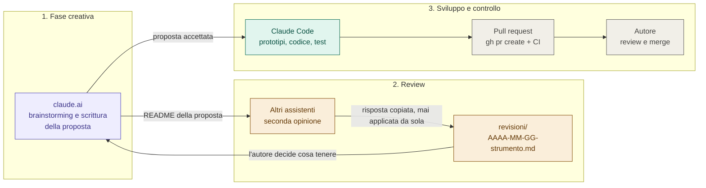
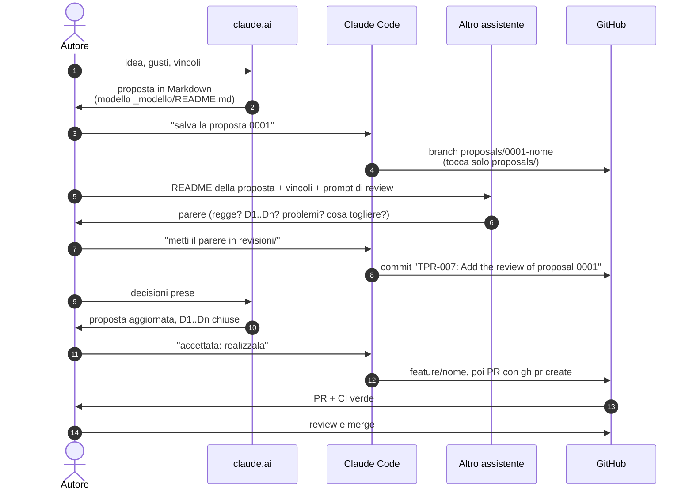
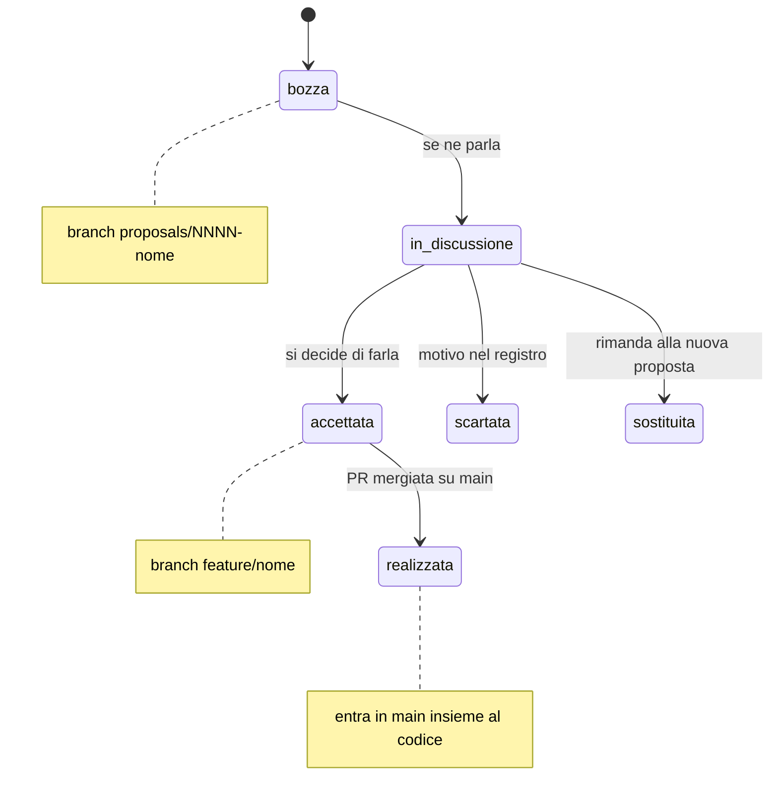
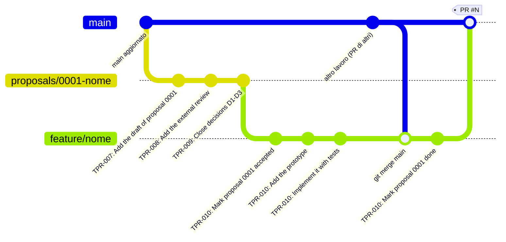
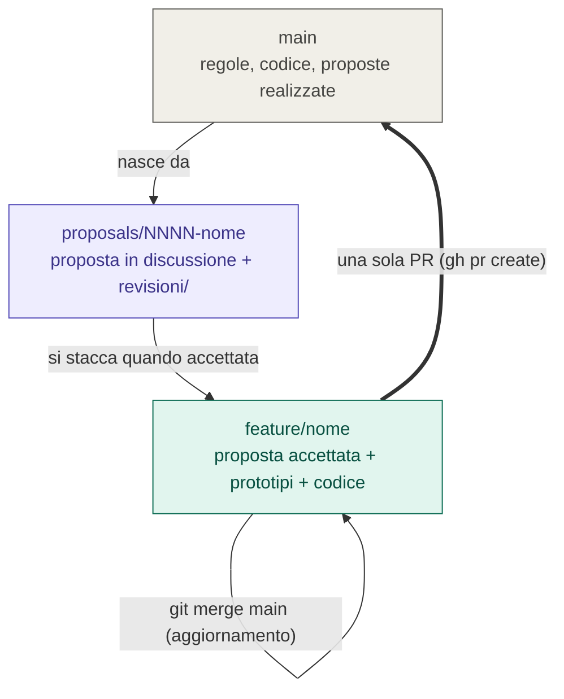

# Lo statuto in pratica: strumenti IA, review e branch

Guida illustrata allo [statuto](../CLAUDE.md): chi fa cosa nella fase creativa,
come funziona la review di un secondo assistente, e quale **strategia di
branch** segue una proposta dall'idea al merge. Le regole di dettaglio restano
in [CLAUDE.md](../CLAUDE.md), [workflow.md](workflow.md) e
[proposals/README.md](../proposals/README.md); qui il quadro d'insieme.

I diagrammi sono Mermaid: GitHub li disegna da solo.

## 1. Le tre fasi e gli strumenti

| Strumento | Fase | Legge | Scrive | Non fa mai |
|---|---|---|---|---|
| **claude.ai** (o altra chat) | creativa | `main`, la proposta | il testo della proposta | codice nel repo |
| **Altri assistenti** | review | README della proposta + vincoli di `CLAUDE.md` | solo la risposta, che finisce in `revisioni/` | modificare la proposta |
| **Claude Code** | sviluppo | tutto il repo | prototipi, codice, documenti, stato e registro | commit senza ok, merge, push su `main` |
| **L'autore** | tutte | tutto | le decisioni | - |

Un assistente **non decide**: propone. Ogni decisione passa dall'autore e viene
scritta nel registro della proposta (`D1`, `D2`, ... con data e motivo).

## 2. La fase creativa e la review, passo per passo

Regole del giro creativo:

- **Il repo è il canale.** claude.ai e Claude Code non si parlano: si passano
  tutto attraverso i file (e le persone).
- **Il parere esterno non cambia la proposta da solo.** Si salva com'è in
  `revisioni/`, poi l'autore scrive in fondo "Cosa ne teniamo" e le decisioni
  vere entrano nel README della proposta e nel suo registro.
- **La proposta è autosufficiente**: chi la legge senza conoscere il progetto
  deve poter rispondere. I vincoli stanno in un posto solo (`CLAUDE.md`).
- I prompt pronti per claude.ai, per Claude Code e per un assistente esterno
  sono in [proposals/README.md](../proposals/README.md#chi-fa-cosa).

## 3. Gli stati di una proposta

| Stato | Branch | Dove vive la proposta |
|---|---|---|
| `bozza`, `in-discussione` | `proposals/NNNN-nome` | solo su quel branch |
| `accettata` | `feature/<nome>` (staccato dal branch della proposta) | su `feature/<nome>` |
| `realizzata` | `main` | in `main`, come storia, col link alla PR |
| `scartata`, `sostituita` | `proposals/NNNN-nome` | resta sul suo branch, col motivo |

## 4. La strategia di branch

Una proposta nasce da `main`, vive su un branch dedicato e **non entra in
`main` finché non è realizzata**. Quando è accettata si stacca la feature dal
branch della proposta e lì si fa tutto; una sola PR riporta in `main` proposta
e codice insieme.

Le regole, in ordine:

1. **`proposals/NNNN-nome`** nasce da `main` aggiornato, così porta le regole e
   il modello più recenti. Tocca **solo** `proposals/`. Qui scrivono la
   proposta (claude.ai, via Claude Code o l'autore) e vanno le revisioni.
2. **`feature/<nome>`** si stacca dal branch della proposta quando questa
   passa ad `accettata`. Qui si chiudono le decisioni aperte e si fanno
   prototipi, test, codice, documenti. Il branch della proposta resta com'era.
3. **Si aggiorna con `git merge main`**, mai con rebase o force push dopo la
   pubblicazione: la storia del branch non si riscrive.
4. **Una sola PR verso `main`**, aperta con `gh pr create` e il
   [template](../.github/pull_request_template.md), quando la proposta è
   completa: decisioni chiuse, criteri di accettazione soddisfatti, codice e
   documenti pronti. Entrano insieme la cartella della proposta (stato
   `realizzata`, registro, riga dell'indice) e il codice.
5. **Review e merge sono dell'autore**: merge commit, mai squash; mai commit
   diretti su `main`.

### Altri branch

| Branch | Quando | Da | Verso |
|---|---|---|---|
| `tpr-XXX-<nome>` | task senza proposta: flusso di lavoro, manutenzione, bug o ritocco piccolo (basta una issue) | `main` | PR su `main` |

### Cosa vede ogni strumento

| Branch | claude.ai | Altri assistenti | Claude Code |
|---|---|---|---|
| `main` | legge le regole | legge i vincoli | legge e (via PR) aggiorna |
| `proposals/NNNN-nome` | scrive la proposta | legge il README | salva proposta e revisioni |
| `feature/nome` | rilegge la proposta | - | prototipi, codice, test, PR |

## 5. Checklist rapida

**Nuova proposta**

- [ ] `git switch main && git pull && git switch -c proposals/NNNN-nome`
- [ ] copia `proposals/_modello/` in `proposals/NNNN-nome/` e scrivi il README
- [ ] commit `TPR-XXX: <commit-message>` (una riga, in inglese), push del branch (nessuna PR finché si discute)
- [ ] review esterna: risposta in `revisioni/`, "Cosa ne teniamo" compilato
- [ ] decisioni chiuse nel README e nel registro

**Realizzazione**

- [ ] `git switch -c feature/<nome>` dal branch della proposta, stato `accettata`
- [ ] test verdi a ogni commit, `git merge main` se serve
- [ ] stato `realizzata`, registro e riga dell'indice aggiornati
- [ ] `gh pr create` con il template; l'autore rivede e mergia
