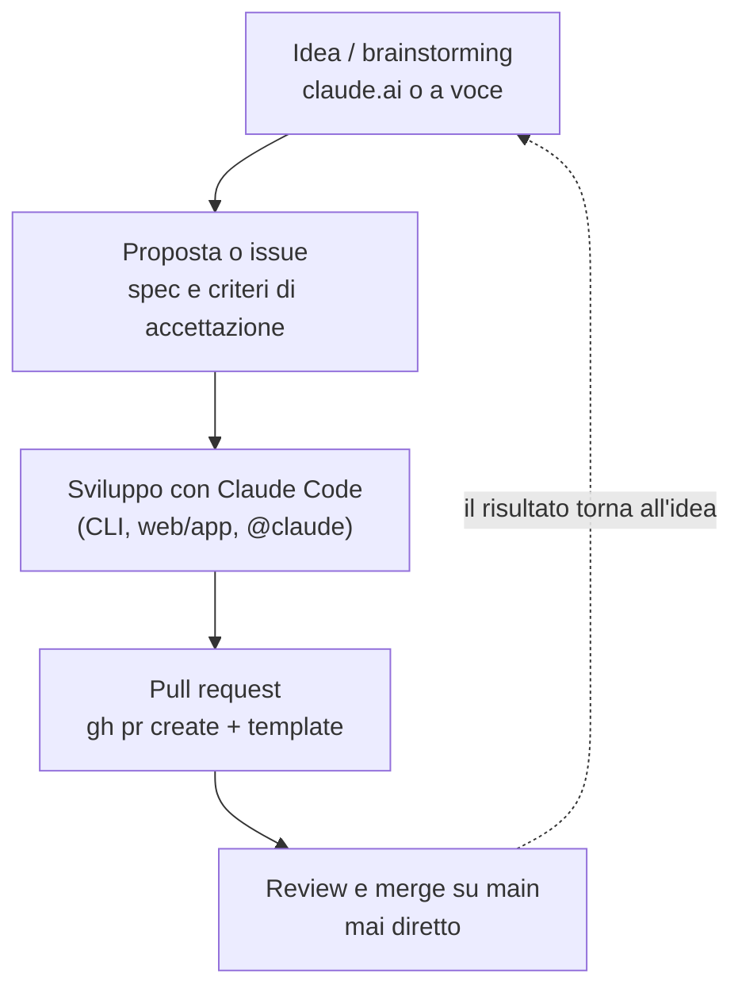

# Flusso di lavoro

Come un'idea diventa codice in questo repo: si pensa, si scrive come proposta,
si sviluppa con un assistente IA, si controlla con una PR. Le regole operative
(branch, commit, convenzioni) sono in [CLAUDE.md](../CLAUDE.md); qui il perché
e il percorso.

Versione illustrata, con la strategia di branch delle proposte:
[statuto-ia.md](statuto-ia.md).

## Ruoli

| Chi | Ruolo | Legge | Scrive |
|---|---|---|---|
| **claude.ai** o altro assistente | ideazione e seconde opinioni | `main`, le proposte | la proposta, sul suo branch; le revisioni in `revisioni/` |
| **Claude Code** | sviluppo: codice, test, documenti | tutto il repo | prototipi, codice, documenti su `feature/<nome>` o `workflow/...` |
| **GitHub** | contratto e controllo | - | - |
| **L'autore** | decide, rivede, mergia | tutto | le decisioni, l'ok ai commit, il merge |

GitHub tiene i due capi del lavoro: il **contratto** (la proposta o la issue
dicono cosa si vuole e quando è fatto) e il **controllo** (la PR mostra cosa è
cambiato, la CI rilancia i test, niente entra in `main` senza review).

## Il percorso

1. **Idea.** Si discute finché si può scrivere: contesto, proposta,
   alternative, decisioni aperte.
2. **Proposta.** In `proposals/NNNN-nome/README.md`, dal
   [modello](../proposals/_modello/README.md), sul branch `proposals/NNNN-nome`
   nato da `main` aggiornato. Per un lavoro piccolo basta una issue.
3. **Accettazione.** La proposta passa ad `accettata` e dal suo branch si
   stacca `feature/<nome>`; le decisioni ancora aperte si chiudono lì.
4. **Sviluppo** su `feature/<nome>`: commit piccoli, test verdi, la CI rilancia
   tutto a ogni push.
5. **Pull request** verso `main`, aperta con `gh pr create` e descritta col
   [template](../.github/pull_request_template.md): cosa cambia, perché, come
   si è provato. Una sola PR quando la proposta è completa.
6. **Review e merge** da parte dell'autore, mai diretto su `main`. La proposta
   entra con il codice, in stato `realizzata` e con il link alla PR.

## Controlli su GitHub

- **CI** ([.github/workflows/test.yml](../.github/workflows/test.yml)): a ogni
  PR e a ogni push su `main` lancia ruff e pytest, con ffmpeg installato.
- **Modelli**: [PR](../.github/pull_request_template.md) e
  [issue](../.github/ISSUE_TEMPLATE/feature.md), volutamente brevi.
- **Protezione di `main`** (PR obbligatoria, CI verde): impostazione del repo
  su GitHub, da attivare dalle impostazioni; non è nel codice.

## Registro

Task (`TPR-XXX`) e milestone (`M<N>`): ogni riga è un lavoro, con il suo branch e la sua PR.
Il prossimo codice libero è il successivo dell'ultima riga. Formato dei codici e dei commit:
[CLAUDE.md](../CLAUDE.md#codici-dei-task).

| Task | Cosa | Branch | PR |
|---|---|---|---|
| TPR-001 | Statuto di cooperazione con gli strumenti IA (e la sua guida illustrata, `statuto-ia.md`), flusso di lavoro, proposte, template PR e issue, CI; README con il logo cuneo-1b e l'installazione come comando; esempio d'uso; `.gitignore` dei file scaricati | `workflow/wf-01-statuto` (nome precedente ai codici TPR) | #1 |
